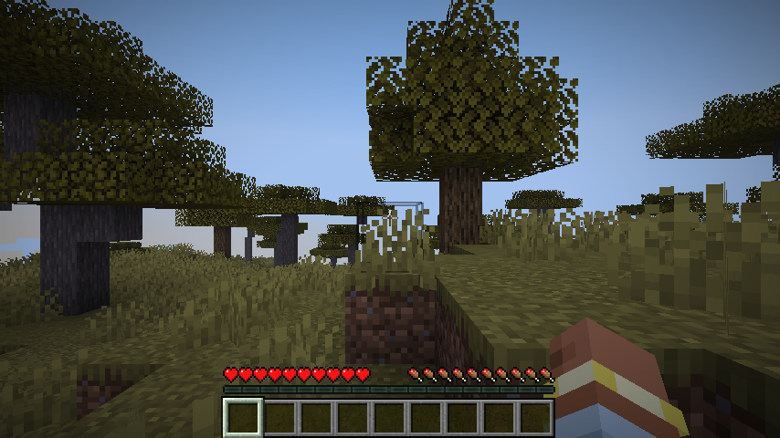

# mine2metal

Mod Fabric yang merender Minecraft Java dengan **Apple Metal** di Mac Apple silicon, lewat lapisan GPU `renderpearl` milik Minecraft sendiri, dan dirancang agar tetap berjalan bersama Sodium. Di atasnya ada upscaling MetalFX dan AMD FSR, frame generation MetalFX dan FSR 3.1, keluaran HDR (EDR), dan shader dunia bawaan (*Natural Cinematic*) yang ditulis langsung dalam Metal Shading Language.

> **In English:** mine2metal renders Minecraft with Apple's Metal on Macs with Apple silicon instead of OpenGL, which macOS has long stopped improving. It plugs into Minecraft's own graphics layer and works alongside Sodium, then adds MetalFX/FSR upscaling, MetalFX/FSR 3.1 frame generation, HDR (EDR) output and a built-in deferred shader pack written in MSL. Requirements: a Mac with Apple silicon (M1 or later), macOS 14 or later, Minecraft 26.3 and Fabric Loader 0.20.1 or later. On any other computer the mod steps aside and the game uses its usual graphics API. The documentation under `docs/` is in Indonesian; the Modrinth/CurseForge description in English is in [docs/rilis.md](docs/rilis.md).



Status: **0.0.1, siap diuji publik**. Semua milestone (M1–M14) dan roadmap lanjutan (R1–R9) selesai; uji otomatis dan validasi Metal API lolos di Metal 4 dan Metal 3. Masih eksperimental: baru diuji di satu Mac (lihat [Hasil pengujian](#hasil-pengujian)), dan mod yang memanggil OpenGL langsung tidak akan menggambar.

## Isi

- [Fitur](#fitur)
- [Persyaratan](#persyaratan)
- [Instalasi](#instalasi)
- [Pengaturan di game](#pengaturan-di-game)
- [Hasil pengujian](#hasil-pengujian)
- [Cara kerja dan struktur kode](#cara-kerja-dan-struktur-kode)
- [Dokumentasi](#dokumentasi)
- [Build, uji, dan debug](#build-uji-dan-debug)
- [Referensi dan kredit](#referensi-dan-kredit)
- [Lisensi dan etika](#lisensi-dan-etika)
- [Batasan yang diketahui](#batasan-yang-diketahui)
- [Berkontribusi](#berkontribusi)

## Fitur

- **Backend Metal untuk `renderpearl`**: `GpuBackend`/`GpuDevice` milik Minecraft 26.3 diimplementasikan di atas Metal, dengan shader SPIR-V diterjemahkan ke MSL. Metal 4 (argument table, residency set) di macOS 26 atau lebih baru, Metal 3 di macOS 14–15. Hasil gambarnya nyaris identik piksel dengan OpenGL (≤ 0,2 % piksel berbeda > 8 level di uji otomatis).
- **Kompatibel dengan Sodium** 0.9.3 (renderer chunk-nya berjalan di atas backend ini) dan dengan renderer chunk vanilla.
- **Upscaling**: MetalFX Spatial, MetalFX Temporal (dengan motion vector dan reactive mask), AMD FSR 1, dan AMD FSR 3.1. Tangan dan HUD tetap di resolusi penuh.
- **Frame generation**: MetalFX frame interpolation (macOS 26+) atau AMD FSR 3.1, dipacu ke refresh rate layar lewat `CAMetalDisplayLink`. Ada pengaman: frame gen *standby* saat game sudah mencapai refresh rate sendiri, dan mematikan diri kalau biayanya lebih besar daripada manfaatnya.
- **HDR (EDR)**: bagian dunia yang paling terang dinaikkan di atas putih SDR pada layar yang mendukung; GUI tetap SDR.
- **Shader dunia bawaan** (preset Low/Medium/High/Ultra/Custom): G-buffer dari terrain Sodium, bayangan voxel DDA dua tingkat + screen-space, GTAO, awan volumetrik, atmosfer, air dengan refleksi screen-space, bloom, light shafts, tonemap ACES. Detailnya di [docs/metal-shaders.md](docs/metal-shaders.md).
- **Halaman pengaturan** di Video Settings milik Sodium (atau tombol "Metal Settings..." tanpa Sodium), tersedia dalam bahasa Inggris dan Indonesia.
- **Paket `.mrpack`** sekali klik untuk Modrinth App dan Prism Launcher.

## Persyaratan

- Mac dengan Apple silicon (M1 atau lebih baru); macOS 14 atau lebih baru (Metal 4 butuh macOS 26).
- Minecraft Java 26.3, Fabric Loader ≥ 0.20.1, Java 25 (bawaan launcher).
- Disarankan: Sodium `mc26.3-0.9.3-beta.1`. Fabric API tidak diperlukan.

Di Mac Intel, macOS lama, atau sistem lain, mod ini tidak melakukan apa-apa: game memakai OpenGL seperti biasa dan layar judul menampilkan alasannya.

## Instalasi

**Sekali klik (Modrinth App atau Prism Launcher):** buka file `mine2metal-<versi>.mrpack` (dari `./gradlew mrpack`, di `build/distributions/`).
- Modrinth App: *Add instance* → *Import* → pilih file `.mrpack`.
- Prism Launcher: *Add Instance* → *Import* → pilih file `.mrpack`.

Paket ini memasang Minecraft 26.3, Fabric Loader 0.20.1, Sodium 0.9.3 (diunduh launcher dari Modrinth, bukan dibundel), dan mine2metal.

**Manual (launcher resmi atau launcher lain):**
1. Pasang [Fabric Loader](https://fabricmc.net/use/installer/) 0.20.1 atau lebih baru untuk Minecraft 26.3.
2. Taruh `mine2metal-<versi>.jar` di folder `mods` (bawaan: `~/Library/Application Support/minecraft/mods`).
3. Disarankan: taruh juga [Sodium](https://modrinth.com/mod/sodium) untuk Minecraft 26.3 di folder yang sama.
4. Jalankan game. Di Options → Video Settings → Graphics API, biarkan **Default** supaya Metal dipakai. Tekan F3: kolom kanan menampilkan `Metal 4 (mine2metal)` atau `Metal 3 (mine2metal)`.

## Pengaturan di game

- Dengan Sodium: Options → Video Settings → di sidebar kiri "mine2metal" → halaman **Metal** dan **Metal Shaders**.
- Tanpa Sodium: Options → Video Settings → tombol **Metal Settings...** di bagian bawah.

| Pengaturan | Isi |
|---|---|
| Versi Metal | Otomatis / Metal 4 / Metal 3 (berlaku setelah restart) |
| Upscaling | Mati / MetalFX Spatial / MetalFX Temporal / FSR 1 / FSR 3.1, dengan Render Scale 50–100 % |
| Pembuatan Frame | Mati / MetalFX / FSR 3.1: satu frame buatan di antara setiap pasang frame, sampai batas refresh rate |
| HDR | EDR dengan slider Kecerahan HDR (125–400 % putih SDR) |
| Shader Preset | Off / Low / Medium / High / Ultra / Custom; mengubah preset langsung menggerakkan opsi turunannya (bayangan, GI, AO, refleksi & air, godrays, bloom, lighting scale) |

Perubahan langsung berlaku dan disimpan di `config/mine2metal.properties`. Mematikan Metal: Graphics API → OpenGL (lalu restart), `enabled=false` di file config, atau `-Dmine2metal.enabled=false`.

## Hasil pengujian

Semua angka di bawah diukur pada **satu mesin**: MacBook Air 15" M3 (Mac15,13, 16 GB, tanpa kipas, panel 60 Hz, desktop 1920×1243 point), macOS 27.0.1, listrik AC. Chip lain (M1, M2, M4 dan seterusnya) **belum diukur**; perkiraan untuk M1 ada di [docs/roadmap.md](docs/roadmap.md#optimasi-shader-dunia-dan-jalur-cpu-2026-10-30). MacBook Air memanas selama benchmark, dan waktu GPU per frame bisa naik sampai 2× tanpa perubahan beban, jadi rentang angkanya lebar; angka tertinggi diukur saat thermal state "nominal". Metode dan tabel lengkapnya ada di [docs/roadmap.md](docs/roadmap.md).

**Backend saja, tanpa shader** (gametest `./gradlew runClientGameTest`, 2026-10-27; vsync mati, frame rate tanpa batas, FPS rata-rata 10 detik):

| Konfigurasi | Ringan: 854×480, melihat ke bawah dari 40 blok | Berat: 1920×1080, render distance 16, horizon |
|---|---|---|
| Metal + Sodium | 2045 – 2772 FPS | 664 – 1528 FPS |
| OpenGL + Sodium | 321 – 488 FPS | 200 – 273 FPS |
| Metal tanpa Sodium | 1794 FPS | 416 FPS |
| OpenGL tanpa Sodium | 224 FPS | 244 FPS |

Catatan jujur: dunia gametest kecil dan hampir tanpa air. Di dunia survival sungguhan pemain, Metal + Sodium di fullscreen 1920×1243 berjalan sekitar 150–200 FPS, dibatasi CPU dan pekerjaan Minecraft sendiri (profil JFR: kode mine2metal ±10 % waktu render thread). GPU hanya ±0,7–0,9 ms per frame di 1900×1200.

**Shader dunia bawaan** (gametest `-Dmine2metal.test.shadersOnly=true`, 2026-10-31, jendela 1600×900, render distance 12, Metal 4 dengan API validation menyala):

| Skenario | FPS |
|---|---|
| Dari atas, shader mati | 1720 |
| Dari atas, preset High | 360 |
| Dari atas, preset Ultra | 274 |
| Di tanah, High, tanpa upscaling | 289 |
| Di tanah, High, MetalFX Temporal 67 % | 241 |

Waktu GPU per pass shader di 1920×1243 (lighting scale 75 %, adegan sintetis `tools/shaderbench`, median): preset High ±3,7 ms total (air + refleksi 1,35, lighting 0,78, resolve 0,50, salinan air + skyline 0,27, bloom 0,23, awan 0,19, post 0,16, light tiles 0,07), turun dari 5,1 ms sebelum optimasi 2026-10-30 tanpa mengubah hasil gambar (dibandingkan per piksel). Ultra ±3,9 ms, Medium ±3,5 ms, Low (50 %) ±2,4 ms.

**Upscaling dan frame generation** (biaya GPU di 1080p–1200p): MetalFX Temporal ±3 ms, FSR 3.1 upscaler ±1,1 ms, MetalFX Spatial ±0,8 ms, FSR 1 ±0,5 ms. Di Minecraft biasa tanpa shader itu lebih mahal daripada seluruh frame, jadi upscaling hanya menguntungkan di Mac yang GPU-bound (misalnya dengan shader Ultra atau resolusi besar). Frame generation menahan game di separuh refresh rate dan baru berguna saat game di bawah refresh rate; pengamannya diuji dengan FPS cap 40 → 59–60 FPS tampil (FSR 3 maupun MetalFX). Kualitas temporal: PSNR 30–35 dB terhadap render asli, turun ±1 dB tepat setelah kamera berputar.

**Kebenaran**: gametest lolos di bawah `MTL_DEBUG_LAYER=1` (Metal API validation) untuk Metal 4 dan Metal 3, termasuk shader, HDR, frame gen, Nether dan End; screenshot Metal vs OpenGL berbeda ≤ 0,21 % piksel (> 8 level). Uji manual yang masih terbuka ada di [docs/uji-manual.md](docs/uji-manual.md).

## Cara kerja dan struktur kode

Minecraft 26.3 memisahkan rendernya ke SPI `renderpearl` (`GpuBackend`, `GpuDevice`, `CommandEncoder`, ...). Mod ini menaruh implementasi Metal di urutan pertama backend yang dicoba, menerjemahkan shader SPIR-V Mojang ke MSL saat runtime, dan menjalankan semua perintah GPU lewat dylib Objective-C yang dipanggil dengan Java FFM (tanpa JNI). Sodium memakai SPI yang sama, jadi renderer chunk-nya ikut berjalan di Metal.

| Path | Isi |
|---|---|
| `src/main/java/dev/mine2metal/metal/MetalBackend.java` | `GpuBackend`: window SDL dengan flag Metal, pembuatan device |
| `src/main/java/dev/mine2metal/metal/MetalDevice.java` | `GpuDeviceBackend`: info device, buffer, tekstur, sampler, pipeline |
| `src/main/java/dev/mine2metal/metal/MetalCommandEncoder.java` | Perekaman perintah, submit, fence, cache view texel buffer |
| `src/main/java/dev/mine2metal/metal/MetalSurface.java` | `CAMetalLayer` dan present |
| `src/main/java/dev/mine2metal/metal/ShaderTranslator.java` | SPIR-V → MSL dengan SPIRV-Cross (lewat `lwjgl-spvc`) |
| `src/main/java/dev/mine2metal/metal/MetalRenderPipeline.java` | Library MSL, layout vertex/blend, pipeline state per format |
| `src/main/java/dev/mine2metal/metal/MetalRenderPass.java` | Binding uniform, scissor, dan semua varian draw |
| `src/main/java/dev/mine2metal/metal/MetalNative.java` | Binding FFM ke `libmine2metal.dylib` |
| `src/main/java/dev/mine2metal/frame/` | Alur per frame: upscaling, frame gen, HDR, shader dunia (`WorldShader`, `SodiumTerrain`) |
| `src/main/java/dev/mine2metal/config/` | Pengaturan, halaman Sodium, layar vanilla |
| `src/main/java/dev/mine2metal/mixin/` | Mixin: urutan backend, tangkapan proyeksi, G-buffer, tambalan GLSL Sodium |
| `src/main/native/` | Library Objective-C (C ABI `m2m_*` di `mine2metal.h`): device, render, MetalFX, HDR, FSR, `shaders.m` + `world_shaders.metal` |
| `src/main/native/fsr/glsl` | Pass FSR yang ditulis ulang untuk GPU Apple, terpisah dari file AMD |
| `third_party/fidelityfx-1.1.4` | Bagian AMD FidelityFX SDK yang dipakai (MIT), disalin oleh `scripts/vendor-fidelityfx.sh` |
| `tools/shaderbench` | Benchmark offline per pass shader, tanpa jendela Minecraft |
| `src/gametest/` | Gametest klien Fabric: screenshot, FPS, PSNR, validasi, mode `shadersOnly`, `hdrOnly`, `walkOnly`, `pacing` |

## Dokumentasi

Semua dalam bahasa Indonesia, di `docs/`:

- [roadmap.md](docs/roadmap.md): milestone M1–M14, R1–R9, hasil uji otomatis, audit performa, optimasi shader, catatan bug dan keputusan berbasis data.
- [riset-awal.md](docs/riset-awal.md): riset SPI `renderpearl` (diverifikasi dengan `javap` pada `client.jar`), Sodium di atas renderpearl, Metal 3 vs Metal 4, prior art, dan daftar sumber.
- [metal-shaders.md](docs/metal-shaders.md): rancangan shader dunia bawaan (arsitektur G-buffer, model cahaya, tata letak memori, preset kualitas).
- [fsr-frame-gen.md](docs/fsr-frame-gen.md): porting FSR 3.1 frame generation dan upscaler AMD ke Metal.
- [uji-manual.md](docs/uji-manual.md): daftar periksa yang hanya bisa dinilai dengan bermain langsung.
- [rilis.md](docs/rilis.md): cara membuat file rilis, isi halaman Modrinth/CurseForge.

## Build, uji, dan debug

Butuh JDK 25 atau lebih baru dan Xcode Command Line Tools (`xcrun clang`). Untuk membangun ulang shader FSR dari GLSL AMD: `glslangValidator` dan `spirv-cross` (keduanya di Homebrew).

```bash
JAVA_HOME=/Library/Java/JavaVirtualMachines/openjdk.jdk/Contents/Home ./gradlew build mrpack
```

```bash
JAVA_HOME=/Library/Java/JavaVirtualMachines/openjdk.jdk/Contents/Home ./gradlew runClient
```

Uji otomatis (membuat dunia, mengambil screenshot ke `build/run/clientGameTest/screenshots/`, mencatat FPS di log):

```bash
MTL_DEBUG_LAYER=1 JAVA_HOME=/Library/Java/JavaVirtualMachines/openjdk.jdk/Contents/Home ./gradlew runClientGameTest
```

Tambahkan `-PnoSodium` untuk menguji renderer chunk vanilla; `JAVA_TOOL_OPTIONS="-Dmine2metal.enabled=false"` untuk pembanding OpenGL; `-Dmine2metal.metal=3` untuk memaksa Metal 3; `-Dmine2metal.test.shadersOnly=true`, `hdrOnly`, `walkOnly`, atau `pacing` untuk bagian tertentu.

Benchmark shader tanpa Minecraft:

```bash
sh tools/shaderbench/build.sh build/shaderbench && build/shaderbench/shaderbench src/main/native/world_shaders.metal 1920 1243 75 3 60 dump.png
```

Debug: `MTL_DEBUG_LAYER=1` (Metal API validation), `MTL_SHADER_VALIDATION=1` (pemeriksaan di dalam shader, lambat), `--renderDebugLabels` (nama encoder untuk Xcode GPU capture). Command buffer yang gagal dicatat sebagai `Metal: Command buffer failed ...` di log.

| Properti JVM | Fungsi |
|---|---|
| `-Dmine2metal.enabled=false` | Mematikan backend Metal tanpa melepas mod |
| `-Dmine2metal.metal=3` | Memaksa Metal 3 |
| `-Dmine2metal.dumpFrame=/path/frame.png` | Menyimpan frame yang dipresentasikan ke PNG |
| `-Dmine2metal.stats=true` | Log tiap 5 detik: FPS, waktu GPU per frame, waktu CPU menunggu GPU, jumlah encoder, volume transfer |
| `-Dmine2metal.passTimes=true` | Seperti `stats`, plus waktu GPU per pass (`M2M_SHADER_TIMES=1` untuk pass shader) |
| `-Dmine2metal.labels=true` | Nama render encoder per pass, untuk Xcode GPU capture atau Instruments |
| `-Dmine2metal.frameGenerationGuard=false` | Mematikan pengaman frame gen (untuk eksperimen) |

Saat memakai `runClient`, properti dioper lewat `JAVA_TOOL_OPTIONS`.

## Referensi dan kredit

Dokumentasi dan sumber yang dipakai selama pengembangan:

- **Mojang**: `client.jar` Minecraft 26.3 (SPI `renderpearl` diinspeksi dengan `javap`; tidak ada kode Mojang yang disertakan) dan metadata versi dari `piston-meta.mojang.com`.
- **Apple Developer Documentation**: [Understanding the Metal 4 core API](https://developer.apple.com/documentation/metal/understanding-the-metal-4-core-api), [MTL4CommandQueue](https://developer.apple.com/documentation/metal/mtl4commandqueue), [MTL4ArgumentTable](https://developer.apple.com/documentation/metal/mtl4argumenttable), [MTLResidencySet](https://developer.apple.com/documentation/metal/mtlresidencyset), [MTL4Compiler](https://developer.apple.com/documentation/metal/mtl4compiler), [CAMetalLayer](https://developer.apple.com/documentation/quartzcore/cametallayer), [MTLIndirectCommandBuffer](https://developer.apple.com/documentation/metal/mtlindirectcommandbuffer), serta dokumentasi MetalFX (spatial/temporal scaler, frame interpolation) dan EDR.
- **AMD FidelityFX SDK v1.1.4** ([GPUOpen-LibrariesAndSDKs/FidelityFX-SDK](https://github.com/GPUOpen-LibrariesAndSDKs/FidelityFX-SDK), MIT): kode host dan shader GLSL FSR 1, FSR 3.1 upscaler, optical flow, dan frame interpolation. Bagian yang dipakai ada di `third_party/fidelityfx-1.1.4` beserta `LICENSE.txt`-nya, dan lisensinya ikut di dalam jar (`META-INF/licenses`). Pass yang ditulis ulang untuk GPU Apple disimpan terpisah dari file AMD.
- **Sodium** ([CaffeineMC/sodium](https://github.com/CaffeineMC/sodium), lisensi Polyform Shield 1.0.0): sumbernya dibaca untuk memahami jalur `renderpearl`-nya, API config-nya, dan render list-nya. Sodium **tidak dibundel**; diunduh pemain atau launcher dari Modrinth.
- **Fabric** (Loader, Loom, Fabric API client gametest; Apache 2.0) dan **Mixin**.
- **LWJGL 3.4.3** (`lwjgl-sdl`, `lwjgl-spvc`): SDL untuk window dan **SPIRV-Cross** (Khronos, Apache 2.0) untuk SPIR-V → MSL. Shader FSR dibangun dengan **glslang** dan **spirv-cross** dari Homebrew.
- **Prior art** yang dibaca sebagai pembanding arsitektur sebelum menulis: [noahdunnagan/mcopt](https://github.com/noahdunnagan/mcopt) (Apache 2.0; backend Metal lewat FFM, tanpa Sodium), [Kausik-Velaga/minecraft-metal-renderer](https://github.com/Kausik-Velaga/minecraft-metal-renderer) (MIT), [GaelQuinta/minecraft-metal-shaders](https://github.com/GaelQuinta/minecraft-metal-shaders) (Apache 2.0). Terima kasih kepada para pembuatnya; catatan perbandingannya ada di [docs/riset-awal.md](docs/riset-awal.md#6-prior-art).
- **Arah visual** shader bawaan terinspirasi dari gaya *Complementary Reimagined* (EminGT); tidak ada kode atau aset shader pack yang dipakai.
- Teknik yang dipakai di shader adalah teknik umum dari literatur grafika real-time: GTAO, interleaved gradient noise, voxel DDA (Amanatides & Woo), screen-space reflections dengan tabel skyline, bloom dual Kawase, tonemap ACES (fit Stephen Hill/Krzysztof Narkowicz), dan FSR/MetalFX seperti di atas.

Proyek ini dikembangkan dengan bantuan Claude (Anthropic) sebagai asisten pemrograman; keputusan desain, pengujian di mesin sungguhan, dan tanggung jawab atas kodenya ada pada pemilik proyek. Commit yang dibantu AI membawa trailer `Co-Authored-By`.

## Lisensi dan etika

- Kode mine2metal berlisensi **MIT** ([LICENSE](LICENSE)). Kode AMD FidelityFX yang disertakan tetap di bawah lisensi MIT AMD.
- Minecraft adalah milik Mojang Studios/Microsoft. Proyek ini tidak berafiliasi dengan, dan tidak didukung oleh, Mojang, Microsoft, Apple, AMD, CaffeineMC, atau Fabric. Tidak ada aset atau kode Minecraft yang didistribusikan ulang.
- Mod ini tidak mengubah mekanika permainan, tidak menyentuh jaringan, dan bersifat klien saja.
- Kalau memakai bagian dari proyek ini di proyek lain, sertakan pemberitahuan lisensi MIT dan, untuk bagian FidelityFX, lisensi AMD.

## Batasan yang diketahui

- Hanya Mac Apple silicon dengan macOS ≥ 14; MetalFX frame interpolation dan Metal 4 butuh macOS 26.
- Mod yang memanggil OpenGL langsung (bukan lewat `renderpearl`) tidak akan menggambar. Iris dan shader pack GLSL belum didukung; pakai shader bawaan.
- Minecraft 26.3 di macOS merender di ukuran *point*, bukan piksel Retina penuh (framebuffer fullscreen "1920×1243", bukan 3840×2486).
- Baru diuji pada M3. Laporan dari chip lain sangat membantu (lihat [Berkontribusi](#berkontribusi)).
- Sodium hanya diuji dengan `mc26.3-0.9.3-beta.1`; deteksi terrain translucent untuk melewati tahap air membaca internal Sodium dan kembali ke jalur aman kalau internal itu berubah.

## Berkontribusi

Laporan bug dan pull request diterima di [HoshizoraAkira/Mine2Metal](https://github.com/HoshizoraAkira/Mine2Metal). Untuk laporan bug, sertakan: model Mac dan versi macOS, versi Minecraft/Fabric/Sodium, baris F3 kolom kanan (`Metal 3/4 (mine2metal)`), `logs/latest.log`, dan kalau bisa screenshot atau frame dari `-Dmine2metal.dumpFrame`. Angka FPS paling berguna bersama `-Dmine2metal.stats=true` dan keterangan ukuran jendela serta render distance.

Sebelum mengirim PR: `./gradlew build` dan `MTL_DEBUG_LAYER=1 ./gradlew runClientGameTest` harus lolos; perubahan pada shader sebaiknya disertai angka `tools/shaderbench` dan perbandingan per piksel seperti di [docs/roadmap.md](docs/roadmap.md).
