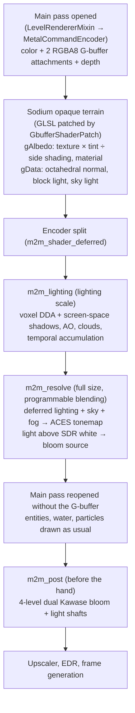

# Design: Native Metal Shader Engine (`mine2metal`)

*English version of [docs/metal-shaders.md](../metal-shaders.md).*

This document lays out the architecture, the mathematical model, the memory layout, the Apple silicon optimisation strategy (the **MacBook Air M3 16 GB** in particular), the tiered quality configuration up to **ray tracing**, and the implementation and testing stages of the **Native Metal Shader Engine** built into `mine2metal`.


> **Status (2026-10-31):** §2, §5 and §6 describe what is in the code. §1, §3 and §4 are the original design; the implementation follows their spirit but with different numbers, and the real numbers are given in the "As implemented" notes in those sections. §7 and §8 have been replaced with the actual C ABI contract and stages.

---

## 1. Background & design philosophy

### 1.1 Why native Metal shaders?
In plain Minecraft without shaders, GPU time on an Apple M3 is only about **0.7–0.9 ms/frame** (with the world/`renderLevel` part only **~0.12 ms**). When a player uses a GLSL-based *shader pack* (Iris/OptiFine style) on macOS instead:
1. **Layered translation overhead:** the old GLSL shaders are translated through several layers and use up to 8–16 G-buffer textures (`colortex0..15` in `RGBA16Float`/`RGBA32Float`).
2. **TBDR bandwidth bottleneck:** the *Tile-Based Deferred Renderer* architecture of Apple silicon GPUs is very fast as long as data stays in tile/register memory or is read from compact compressed textures, but performance drops sharply, with thermal throttling (above all on the fanless MacBook Air M3), when forced to write and re-read tens of megabytes of G-buffer in every pass.
3. **No native Apple silicon features:** the GLSL path does not use `half` (`float16`) throughout (2× the throughput and half the register pressure of `float`, which enables **Dynamic Caching** on the M3 GPU), has no direct access to Metal's acceleration/traversal structures, and is not connected to the **MetalFX Temporal Upscaler**, **FSR 3.1 Frame Generation** or **EDR (HDR) output**.

### 1.2 Visual direction: *Natural Cinematic*
By design decision, the built-in look follows a **Natural Cinematic** direction (inspired by *Complementary Reimagined*):
- **Keeping Minecraft's block identity:** block albedo stays clear and recognisable, not swallowed by excessive dark contrast or extreme color shifts.
- **Living sky, atmosphere and water:** *Rayleigh/Mie scattering* gradients at sunrise and sunset, soft *crepuscular godrays* through gaps in the trees, water surfaces with fine waves, depth refraction (*water absorption*), and clear reflections of sky and world.
- **Warm emissive lighting:** lava, lanterns, glowstone, sea lanterns, froglights and torches cast warm ambient (*bounce/indirect*) light on nearby walls and trigger a soft *bloom* (and EDR highlights on displays that support it).

---

## 2. Architecture: a G-buffer from Sodium's terrain

The first version of these shaders was a pure *post-process* on top of the finished image. Its colors already carried the lightmap, block-side shading, AO and vanilla fog. Normals were guessed from depth and materials from color. The result was muddy (light applied twice), fog doubled, and water misdetected. Shader packs like Complementary work at the stage where the world itself is drawn, so the current version does the same:



- **The GLSL patch** is applied in `GlslCompiler.compileToSpv` (`GlslCompilerMixin`), before Mojang compiles Sodium's shaders to SPIR-V. The OIT variant (`#ifdef OIT`) is left alone. Extra outputs with no attachment are discarded by Metal (tested under API validation).
- **The terrain pipeline** has a state variant with two extra RGBA8 targets (`MetalRenderPipeline.state(..., gbuffer)`). Other pipelines in the same pass get write mask 0.
- **The pass split** happens right after `ChunkSectionsToRender.renderGroup(OPAQUE)` in `LevelRenderer.executeSolid`. `MetalRenderPass.resumeWithoutGbuffer` re-applies the pipeline, scissor, vertex buffers, push constants and uniforms on the new encoder.
- **The lighting model** (`world_shaders.metal`): sun × shadow × N·L (leaves translucent from both sides + scattering), sky × sky light² × AO, block light following Minecraft's light level (so walls still block it) with its color taken from the nearest light source (blue soul lanterns, etc.), and emission from the voxel grid or full-bright surfaces.
- **Dimensions**: the G-buffer is attached in every dimension; the kind is read from the skybox (overworld, `NONE` like the Nether, `END`), so data-pack dimensions follow. In the Nether and the End there is no sun, no sun shadow, no sky light and no clouds. Ambient comes from the dimension's fog color (Nether) or a pale purple (End), the vanilla sky is kept, and fog follows vanilla's so it matches entities and particles. Lava, glowstone and End crystals glow through the voxel grid and bloom.
- **Entities**: `GbufferShaderPatch` also patches `minecraft:core/entity`. Albedo is the raw `Color` × texture × `ColorModulator` (plus the red overlay on damage), normals from position derivatives, light from `UV2`. Deferred lighting moves to the end of `LevelRenderer.executeSolid`, so solid entities and block entities also get sun, shadows, AO and sky light. Blended overlays (glint, glowing eyes) are not patched. Other pipelines drawing in that window use a "marker" MSL variant (one `[[color(1)]]` output of zero), so their pixels are left as vanilla drew them.
- **Items & particles**: `minecraft:core/item` is patched like entities, so dropped items, item-frame contents and so on get deferred lighting. Solid particles (`core/particle`, the `opaque_particle` pipeline) write material 4: since billboards always face the camera, the resolve gives them constant diffuse light (no N·L), but they still get voxel shadows, AO, sky light and block light. Semi-transparent particle pixels are marked material 0. Translucent particles are drawn after the deferred stage and stay vanilla.
- **Water**: before `renderGroup(TRANSLUCENT)` in `executeClassicTransparency`, the main pass is split again. The opaque scene's color and depth are copied, then the translucent terrain is drawn with the G-buffer (water is recognised from the biome tint, +16 in the material). Afterwards `m2m_water` redraws the water pixels: procedural waves, refraction from the scene copy, Beer–Lambert absorption by depth, SSR + sky, and Fresnel. Particles, weather and translucent entities continue on top. It does not run when Improved Transparency (OIT) is on or when Reflections & Water = Off.
- **Under water**: with the camera in water (overworld), `FogRendererMixin` removes vanilla's environmental fog from the GPU buffer. The original value is still used as the view distance. `m2m_post` then draws per-color absorption fog (red goes first) with the biome's fog color, plus light beams from a caustic pattern projected from the surface (the surface height is found in Java). Submerged surfaces (voxel in front is water) get caustics in the resolve, so they show from above and below. `m2m_water` handles the surface from below: Snell's window with the sky/world above, and total internal reflection outside it.
- **Rain**: only when it really rains in the camera's biome (`Biome.getPrecipitationAt == RAIN`; not snow or desert). Surfaces open to the sky get darker, more saturated and slightly glossy. Flat solid surfaces get puddles (world-stable noise that spreads as the rain gets heavier) reflecting the sky with Fresnel, plus ring ripples from raindrops. The same ripples appear on water.
- **Reversed-Z**: MC 26.3 calls `setPerspective` with near/far swapped, so depth is 1 near and 0 far/sky. The shader converts depth to distance through `m32 / (depth + m22)` and recognises the sky from the clear value, so it stays right under both conventions.
- **Optimisation**: voxel rays stop above the grid's highest block (`columnTops`) and skip empty 4×4×4 coarse blocks (`m2m_voxel_coarse`). The water SSR stops as soon as its screen path can only read sky (skyline table, `m2m_skyline_reduce` + `m2m_skyline_levels`). Point lights are culled per 32×32 tile (`m2m_light_tiles`) and only evaluated at pixels with block light. Cloud/wave/puddle noise comes from a 3D texture, the sky color from a per-frame LUT (`m2m_sky_lut`). Shadows, AO and clouds alternate per pixel (temporal checkerboard). Clouds have their own pass at half the lighting resolution, cloud self-shadow samples use 1 octave, and cloud shadows on the ground are only computed at pixels still lit by the sun. Light shafts (in air and under water) run in a half-resolution pass. The SSAO reach on screen is bounded. The voxel grid is written by the CPU into a master copy, then copied into one of 4 GPU buffers only when its version changes, so the CPU never writes a buffer the GPU is reading. `M2M_SHADER_TIMES=1` with `-Dmine2metal.passTimes=true` shows GPU time per stage, and `-Dmine2metal.shaderDebug=1..8` shows intermediate buffers (1 shadows, 2 AO, 3 normals, 4 lightmap, 5 voxels).
- **The voxel grid** is updated at once when a block changes (`ClientLevelMixin` → `sendBlockUpdated`). The rotating scan still runs for newly loaded chunks.

## 3. A 3D world representation for shadows & ray tracing (hybrid voxel + screen space)

The biggest challenge of pure *post-processing* shaders is their ignorance of off-screen geometry: as soon as the player looks down and the sun or a torch leaves the screen, the shadows of trees/roofs or the torch light suddenly vanish.

To solve this natively on Apple silicon with minimal memory (only **2 MB of RAM** out of the 16 GB available):

### 3.1 The 3D voxel texture layout (`128 × 128 × 128`, `MTLPixelFormatR8Uint`)
A `128 × 128 × 128` voxel grid centred on the player's camera (a radius of ±64 blocks in every direction) with **toroidal wrapping** (`voxelCoord = worldBlockPos & 127`).
- Thanks to toroidal addressing (`modulo 128`), as the player walks we **never re-copy the whole grid**. Only the slice of new blocks at the leading edge of the camera's motion, or chunks/blocks that changed, are re-uploaded from CPU to GPU.
- Memory: `128 × 128 × 128 × 1 byte = 2,097,152 bytes (2.0 MB)`.

### 3.2 8-bit encoding per voxel (`uint8_t`)
Each voxel byte stores the opacity kind and the block's emission color/intensity at once:

| Byte value (`uint8_t`) | Block category | Behaviour during *ray traversal* |
| :--- | :--- | :--- |
| `0x00` | Air / empty (`air`, short grass, small flowers) | The ray passes unhindered (`transmittance = 1.0`). |
| `0x01` | Solid opaque block (stone, dirt, wood, ore, buildings) | Stops the ray completely (`hit = true`, a hard shadow caster). |
| `0x02` | Foliage / semi-transparent (`leaves`, cobweb, bamboo) | Attenuates the ray by the leaf factor and adds a slight natural green tint (*subsurface foliage transmission*). |
| `0x03` | Water (`water`) | Refracts and absorbs light by depth (*Beer–Lambert absorption*). |
| `0x04..0x0F` | Stained glass / ice (`glass`, *stained glass*, `ice`) | Passes the ray through an RGB filter of the glass color (*colored stained-glass shadows*). |
| `0x10..0xFF` | **Emissive blocks (light sources)** | Bits `7..4` = emission palette (1: fire/torch/lava orange, 2: warm glowstone/lantern yellow, 3: soul fire/soul lantern blue, 4: sea lantern cyan, 5: amethyst/crying obsidian/end rod purple, 6: froglight green/yellow/purple, 7: bright white); bits `3..0` = light intensity (`1..15`). |

### 3.3 The active emissive point-light list (design: 256 sources; implemented: the 32 nearest)
Besides the voxel grid for ray marching, `WorldShader.java` also gathers the nearest block light sources (design **256**; implemented **32**, `MAX_LIGHTS` in `WorldShader.java` and `M2M_MAX_POINT_LIGHTS` in `shaders.m`) into a compact array (`float4 positionAndRadius`, `float4 colorAndIntensity`) inside the frame's uniform buffer. With this list:
- On the **Low / Medium** presets, walls near torches/lava get smooth dynamic illumination without firing dozens of ray-tracing rays per pixel.
- On the **High / Ultra (RT)** presets, the ray-tracing rays use **Next-Event Estimation (NEE) / importance sampling** straight towards the nearest emissive sources and verify their visibility (blocked by a wall or not) through *3D DDA voxel traversal*. The result: **accurate torch/lava shadows behind walls and pillars without speckle noise.**

---

## 4. Algorithm specification per shader stage (MSL)

All shaders are written in **Metal Shading Language (MSL)** in `src/main/native/world_shaders.metal` (compiled at run time by `shaders.m`), with precision split as follows:
- **3D positions, depth and projection matrices:** `float` (`fp32`), to stay free of jitter and far-distance banding.
- **Normals, light directions, RGB colors, AO and BRDF coefficients:** `half` / `half3` / `half4` (`fp16`), to double the ALU rate on the Apple M3 GPU.

> **As implemented (from `world_shaders.metal`):** normals and materials are no longer reconstructed from depth but read from the G-buffer (§2). Step counts per quality: screen-space shadows 24 / 36 / 48 / 64 (Low–Ultra) with cone widths 0.006 / 0.012 / 0.02, voxel DDA 10 steps (Low–Medium) or 16 (High–Ultra) above the coarse grid; AO 3 / 4 / 6 samples and only within 96 blocks; water SSR 12 / 18 / 26 steps (Medium–Ultra) plus the skyline table; light shafts 8 / 12 / 16 steps; clouds 6 / 8 / 11 steps; the "RT" reflections and AO at Ultra use the same voxel DDA, not Metal acceleration structures. Sections 4.1–4.6 below are the original design.

### 4.1 3D position reconstruction & sharp surface normals (pass 0, original design)
Because Sodium draws the world straight into the color and depth targets without an extra normal G-buffer attachment, we reconstruct the 3D world position $\mathbf{P}$ and the geometric normal $\mathbf{N}$ on the fly from the `depth` texture:
1. For a pixel at UV $(u, v)$ with depth $d \in [0, 1)$, the camera-relative position is:
   $$\mathbf{P}_{\text{clip}} = \begin{bmatrix} 2u - 1 \\ 2v - 1 \\ d \\ 1 \end{bmatrix}, \quad \mathbf{P}_{\text{world}} = \text{invViewProj} \cdot \mathbf{P}_{\text{clip}}$$
2. So that block edges do not look rounded at depth silhouettes, the partial derivatives $\partial \mathbf{P} / \partial x$ and $\partial \mathbf{P} / \partial y$ are taken from whichever left/right and up/down neighbour pair has the smallest $|\Delta d|$ (*min-depth derivative reconstruction*):
   $$\mathbf{N} = \text{normalize}\left(\Delta \mathbf{P}_x \times \Delta \mathbf{P}_y\right)$$
3. **Fast material classification from albedo & normal:**
   - **Sky:** $d \ge 0.99999$.
   - **Water:** detected from the translucent blue/cyan chromaticity + a horizontal surface normal ($N_y > 0.85$), or a block coordinate whose voxel is `0x03`.
   - **Emissive surfaces:** voxel `>= 0x10`, or pixels with very high local luminance in a dark area.
   - **Foliage/grass:** detected from voxel `0x02`, for the *subsurface scattering* effect when facing away from the sun.

### 4.2 Shadow system (*Shadow Quality*)
1. **Low (*screen-space contact shadows*):**
   - 16 *ray-march* steps through the screen-space depth towards the sun/moon over 2.5 world metres, giving sharp contact shadows on grass, stones and block crevices.
2. **Medium (*soft screen-space + horizon shadows*):**
   - 24 screen-space ray-march steps with *Interleaved Gradient Noise (IGN)* spatial jitter + a *soft penumbra* based on occluder distance.
3. **High (*hybrid 3D voxel DDA + screen-space shadows*):**
   - Combines a short-range screen-space ray march (0–1.5 blocks for non-cube micro detail such as fences/stairs/entities) with **Amanatides & Woo 3D DDA voxel traversal** up to 48 steps through the 3D voxel texture (`128³`).
   - Trees, roofs, cliffs and caves cast consistent sun shadows even when the occluder is behind the camera.
4. **Ultra (*ray-traced PCSS + colored translucent shadows*):**
   - Fires *cone/jittered* rays towards the sun disc (*disk sampling*) through the 3D voxel grid up to 80 steps:
     - The average blocker distance sets the penumbra width (**Percentage-Closer Soft Shadows / PCSS**): sharp at the foot of a tree, softer and more diffuse further away.
     - When a ray crosses a leaf voxel (`0x02`) or stained glass (`0x04..0x0F`), the shadow color is filtered physically, giving **colored stained-glass shadows** and gaps of light through foliage.

### 4.3 *Ambient occlusion* (`SSAO` / `GTAO` / `RTAO`)
1. **Low (`SSAO`):** 6 hemisphere samples in screen space with a depth-adaptive radius.
2. **Medium (`GTAO`, *Ground-Truth Ambient Occlusion*):**
   - Computes horizon angles around the pixel in 2 slice directions × 4 steps per side with `half` (`FP16`) arithmetic, giving room corners and block crevices far more physically accurate shading than plain SSAO.
3. **High (`RTAO`, *Ray-Traced Ambient Occlusion*):**
   - Fires short *cosine-weighted hemisphere* rays (radius 1.5–4 blocks) through the 3D voxel grid + screen space to catch occlusion from off-screen blocks (such as a cave ceiling overhead), then smooths it with a *spatial-temporal denoiser*.

### 4.4 *Global illumination & dynamic emissive lighting* (`Low` / `SSGI` / `RTGI`)
1. **Low (*sky & sun bounce tint*):**
   - Sky hemisphere lighting (cool blue on upward-facing surfaces) + a warm ground bounce on surfaces facing away from the sun.
2. **Medium (`SSGI` + *direct emissive lights*):**
   - *1-bounce screen-space diffuse GI* + direct illumination (smoothed *inverse-square falloff*) from the nearest emissive block lights (implemented: up to 32).
3. **High (`RTGI`, *voxel ray-traced GI & shadowed emissive bounce*):**
   - Tests ray visibility (a *shadow ray* through 3D voxel DDA) from the pixel to nearby emissive sources (lava, torches, lanterns, glowstone) so that **torch light does not pass through walls**, plus *color bleeding* from nearby blocks in direct sunlight.

### 4.5 Reflections & water (*Reflections & Water*)
1. **Low (*Fresnel sky & sun specular*):**
   - Light procedural normal waves on water + Schlick's Fresnel law:
     $$F(\theta) = F_0 + (1 - F_0)(1 - \cos\theta)^5, \quad F_0 = 0.02$$
   - Reflects the atmospheric sky gradient and the sun/moon disc highlight (*GGX specular*).
2. **Medium (`SSR`, *screen-space reflections*):**
   - Fires the reflected ray $\mathbf{R} = \text{reflect}(-\mathbf{V}, \mathbf{N}_{\text{wave}})$ through the screen-space depth (24 hierarchical/linear steps with *binary refinement*).
3. **High (*SSR + dual-layer Gerstner waves + depth refraction*):**
   - Multi-octave water waves moving smoothly, *Beer–Lambert underwater color absorption* (shallow water clear and greenish, deep water dense blue), thin *foam* at block contact edges, and 36-step SSR.
4. **Ultra (*hybrid ray-traced reflections*):**
   - When an SSR ray leaves the screen or is blocked by a foreground object (*disocclusion*), it continues its traversal inside the **3D voxel grid** to reflect off-screen cliffs, buildings, foliage and lights/lava, blended with the atmospheric sky.

### 4.6 Atmosphere & *volumetric lighting (godrays)*
- **Natural Cinematic atmospheric scattering:**
  - The sky gradient is computed from the sun elevation angle $\mu = \mathbf{V} \cdot \mathbf{L}_{\text{sun}}$ with smooth transitions between:
    - **Day:** bright sky blue with a soft white-blue *horizon haze*.
    - **Golden hour (sunrise / sunset):** warm golden orange around the sun grading to violet at the zenith.
    - **Night:** a deep cinematic night blue with silver-blue moonlight (still comfortable to play, never pitch black).
    - **Rain / storm:** automatic atmospheric desaturation with thick layered fog and wet-looking ground/stone (*wetness specular*).
- **Volumetric godrays (*crepuscular rays*):**
  - Volumetric *ray marching* along the view vector $\mathbf{V}$ (8 / 16 / 24 steps with *blue-noise / IGN dithering*): tests whether each air sample is in direct sunlight (through the *depth buffer* & *3D voxel shadow check*) and accumulates **Henyey–Greenstein** phase scattering ($g = 0.76$).
  - When the player is under water (`isUnderwater`), the godrays become *underwater caustic shafts*.

### 4.7 *Dual-Kawase bloom* & *Natural Cinematic tonemapping*
- **Dual-Kawase pyramid bloom:**
  - 4 *downsample* levels (`1/2`, `1/4`, `1/8`, `1/16`) and 4 *upsample* levels with a 5-tap *tent* filter. GPU cost on the M3 below **0.15 ms** at 1080p/1200p, since the textures shrink exponentially.
- **Natural Cinematic tonemapping (SDR & EDR/HDR compatible):**
  - Turns the *linear HDR* lighting result into the final color with an *ACES-inspired Natural Cinematic* curve (keeping sky and block saturation natural without washing reds/yellows out):
    - **In SDR (`hdr == false`):** mapped to $[0, 1]$ then re-encoded to sRGB.
    - **In EDR/HDR (`hdr == true`):** a *soft-shoulder* curve lets luminance above `1.0` flow smoothly up to `hdrFramePeak` (200–400 % of SDR white), so `hdr.m` and *frame generation* receive consistent color data.

---

## 5. Optimisation strategy for the MacBook Air M3 (16 GB)

So that the shaders run smoothly on a MacBook Air M3 without triggering thermal throttling:

| Technique | Implementation in `mine2metal` | Performance effect |
| :--- | :--- | :--- |
| **1. *Configurable lighting scale* (`50%`, `75%`, `100%`)** | The heavy passes (shadows, AO, GI, godrays, reflections) run on a texture of `shaderLightingScale` size (default `75%`, or `50%` in the economy mode), then join full resolution through **joint bilateral upsampling** (weighted by depth & normal so block edges stay 100 % sharp). | Saves **44–75 %** of the ray-marching load without blurring block textures. |
| **2. *Spatial-temporal reprojection* (history accumulation)** | The lighting textures keep the previous frame's history (`lightingHistory[2]`), reprojected with the `previousViewProjection` matrix from `CameraMotion`. | Lets the ray-tracing sample count per frame stay low (1–2 rays/pixel) while reaching the quality of 16–32 samples over 4–8 frames. |
| **3. `half` (`FP16`) throughout** | All BRDF math, color interpolation, bilateral filters and bloom use `half` / `half3` / `half4`. | Enables *dual-issue FP16* and keeps register use below the M3's **Dynamic Caching** threshold. |
| **4. *Early-out* for sky & distance** | Sky pixels (`depth == 1.0`) skip the whole shadow, AO and GI loops. Objects beyond the shadow radius use *analytic sky/sun shading* at once. | Cuts **30–50 %** of shader instructions when the player looks at the horizon. |
| **5. *Incremental toroidal voxel update*** | In Java (`WorldShader.java`), one grid row (97 columns with the same world z) is scanned per frame and written into the *off-heap* master copy (`2 MB`); the changed z slices are reported to native (`m2m_shader_voxels_changed`), and each GPU copy copies only its pending slices (16 KB per slice). | Extra CPU load below **0.15 ms/frame** and RAM use steady at **2 MB**. |
| **6. Skyline for water SSR** | Two compute kernels build a table of the highest non-sky row per 16-column band plus a sparse range-max table. A ray's screen path is a line, so `sky_from` computes once per ray from which distance every sample is surely sky, and the ray stops there. | Water pass 2.02 → 1.40 ms (1920×1243), identical result (≤ 1 level). |
| **7. Light tiles** | A compute kernel per 32×32 tile: each point light's sphere is tested against the tile's frustum and depth range; the resolve iterates only the lights that passed, and only at pixels with block light. | Resolve 0.94 → 0.54 ms; 0 pixels differ. |
| **8. Two-level voxel DDA** | A coarse 32³ grid (a byte per 4×4×4 block, built by a kernel when the voxel copy updates); rays skip empty coarse blocks to their exit point. | Lighting 0.90 → 0.78 ms; 8 pixels differ by ≤ 2 levels. |
| **9. Noise and sky from textures** | Value noise from a 128³ R16Unorm 3D texture (periodic over 32 units, 4 texels/unit) replaces 8 hashes + 7 mixes per sample; `atmosphere()` is computed once per frame into a 512×256 lat-long LUT and sampled. | Clouds 0.57 → 0.19 ms; the LUT saves about 0.25 ms across water, resolve and clouds. |
| **10. Clip-space marching** | SSR and AO samples project once; each step is a multiply-add. | Small, but free. |
| **11. The water stage only with translucent terrain** | `SodiumTerrain` reads Sodium's render lists (the TRANSLUCENT pass storage per region + each section's slice mask) before the scene copy; without translucent sections, the copy, skyline and water pass are skipped. | About 0.3 ms in scenes without water. |
| **12. Hardware sRGB** | Resolve, water and post draw into sRGB views of the color texture and read the scene copy through an sRGB view; the `linearIo` function constant selects a pipeline variant without conversions (formats with no sRGB variant use the variant with explicit conversions). | About 0.1 ms. |

Total shader passes at 1920×1243 (Apple M3): High 5.11 → 3.81 ms, Ultra 5.47 → 3.98, Medium 4.56 → 3.58, Low 50 % 2.90 → 2.48. The tool is `tools/shaderbench` (a synthetic world, each pass in its own command buffer; details in the [roadmap](roadmap.md#world-shader-and-cpu-path-optimisation-2026-10-30)).

---

## 6. Settings & quality presets

### 6.1 The preset matrix (`ShaderPreset`)

| Option | `OFF` | `LOW` | `MEDIUM` | `HIGH` | `ULTRA (RT)` |
| :--- | :---: | :---: | :---: | :---: | :---: |
| **Shadow Quality** | `OFF` | `LOW` (Contact) | `MEDIUM` (Soft SS) | `HIGH` (Voxel Hybrid) | `ULTRA` (RT PCSS + Colored) |
| **Ambient Occlusion** | `OFF` | `LOW` (SSAO) | `MEDIUM` (GTAO) | `MEDIUM` (GTAO) | `HIGH` (RTAO) |
| **Reflections & Water** | `OFF` | `LOW` (Fresnel) | `MEDIUM` (SSR) | `HIGH` (SSR + Waves) | `ULTRA` (RT Hybrid) |
| **Global Illumination** | `OFF` | `LOW` (Sky Bounce) | `MEDIUM` (SSGI + Lights) | `HIGH` (RTGI + Shadowed Lights) | `HIGH` (RTGI + Shadowed Lights) |
| **Volumetric Godrays** | `OFF` | `LOW` (8 steps) | `MEDIUM` (16 steps) | `HIGH` (24 steps) | `HIGH` (24 steps) |
| **Bloom & Tonemap** | `OFF` | `LOW` | `MEDIUM` | `HIGH` | `HIGH` |
| **Lighting Scale** | `75%` | `50%` | `75%` | `75%` | `75%` (adjustable `50%–100%`) |

> [!TIP]
> When the user picks `LOW`, `MEDIUM`, `HIGH` or `ULTRA`, the six sub-options fill in from the table above. If the user changes one sub-option by hand (for example the `MEDIUM` preset with **Reflections & Water** raised to `ULTRA`), **Shader Preset** moves to `CUSTOM` on its own.

### 6.2 Storage keys in `config/mine2metal.properties`
```properties
# Native Metal Shaders (Natural Cinematic)
# shaderPreset: off | low | medium | high | ultra | custom
shaderPreset=off
shaderShadows=off
shaderAo=off
shaderReflections=off
shaderGi=off
shaderVolumetrics=off
shaderBloom=off
shaderLightingScale=75
```

### 6.3 UI layout (Sodium & vanilla)
1. **In Sodium (`SodiumOptionsPage.java`):**
   - A second page/tab named **"Metal Shaders"** (`mine2metal.options.shaders_page`) right below/next to the **"Metal"** page:
     - **Group 1 — Preset & lighting resolution:** `Shader Preset`, `Shader Lighting Scale (50%–100%)`.
     - **Group 2 — Shadows & lighting (ray tracing):** `Shadow Quality`, `Global Illumination (GI)`, `Ambient Occlusion`.
     - **Group 3 — Water, reflections & camera effects:** `Reflections & Water`, `Volumetric Godrays`, `Bloom & Tonemapping`.
2. **In the vanilla screen (`MetalSettingsScreen.java`):**
   - A **"Metal Shaders"** header section with cycle buttons and a slider that stay in sync when the user changes `Shader Preset`.

---

## 7. The C ABI contract (`mine2metal.h`) & native data structures

### 7.1 Per-frame data from Java to native
Sent through `m2m_shader_deferred`, `m2m_shader_water_end` and `m2m_shader_post` (`WorldShader.java` fills it in `prepare` and `fillEnvironment`):
- `quality[0..6]` (`int32`): shadows, AO, reflections, GI, volumetrics, bloom (enum ordinals, 0 = off), lighting scale %.
- `matrices[0..51]` (`52 float`): this frame's `invViewProj`, the previous frame's `viewProj`, `cameraDelta (dx, dy, dz, valid)`, then this frame's `viewProj` (the `CameraMotion` layout).
- `environment[0..35]` (`36 float`): `[0..2]` camera world position; `[3]` seconds since the shaders started; `[4..6]` sun/moon direction; `[7]` daylight factor; `[8]` twilight factor; `[9]` rain; `[10]` thunder; `[11]` the camera's fluid mode; `[12]` dimension (0 overworld, 1 Nether, 2 End); `[13]` EDR peak (0 = SDR); `[14..15]` the projection's `m22`, `m32` (depth → distance); `[16..18]` sky color; `[19]` frame counter (mod 1024); `[20..22]` fog color; `[23]` sun elevation; `[24..27]` environmental fog and render-distance fog ranges; `[28]` gamma; `[29]` night vision; `[30]` `-Dmine2metal.shaderDebug`; `[31]` voxel ceiling; `[32]` water surface height when submerged; `[33]` camera in water; `[34]` voxel grid version; `[35]` rain in the camera's biome.
- `lights` (up to 32 × 8 floats): `x, y, z, radius, r, g, b, intensity` relative to the camera, with `light_count`.

### 7.2 Exports in `mine2metal.h`
```c
// Address of the voxel grid's master copy (128^3 bytes) that Java writes; 0 when there is none yet.
M2M_EXPORT int64_t m2m_shader_voxel_buffer(int64_t ctx);
// The z slices (0..127) written since the last call; the GPU copies copy only those.
M2M_EXPORT void m2m_shader_voxels_changed(int64_t ctx, int32_t z_min, int32_t z_max);
// Attaches the two G-buffer targets to the main pass about to open.
M2M_EXPORT int32_t m2m_shader_gbuffer_attach(int64_t ctx, int64_t color, int64_t depth);
// After the opaque terrain: lighting at the lighting scale, then the resolve into the color texture; the main pass reopens.
M2M_EXPORT int32_t m2m_shader_deferred(int64_t ctx, int64_t color, int64_t depth, const int32_t *quality,
                                       const float *matrices, const float *environment, const float *lights, int32_t light_count);
// Before/after the translucent terrain: the scene copies, the water G-buffer, then the water pass.
M2M_EXPORT int32_t m2m_shader_water_begin(int64_t ctx, int64_t color, int64_t depth);
M2M_EXPORT int32_t m2m_shader_water_end(int64_t ctx, int64_t color, int64_t depth, const int32_t *quality,
                                        const float *matrices, const float *environment);
// Before the hand: bloom, light shafts, underwater fog.
M2M_EXPORT int32_t m2m_shader_post(int64_t ctx, int64_t color, int64_t depth, const int32_t *quality,
                                   const float *matrices, const float *environment);
// Releases every shader texture and buffer when turned off.
M2M_EXPORT void m2m_shader_release(int64_t ctx);
```
The exact signatures are in `src/main/native/mine2metal.h`; the Java bindings in `MetalNative.java`.

---

## 8. Stages as carried out

| Stage | Contents | Result |
| :--- | :--- | :--- |
| 1. Configuration, presets & UI | `MetalSettings`, the Sodium "Metal Shaders" page, the vanilla screen, English and Indonesian; the preset moves its derived options and a derived option moves the preset to Custom (on the Sodium page through `ShaderPresetSync`, 2026-10-31) | Done, covered by the game test |
| 2. The first post-process shaders | Lighting from depth and the finished color | Replaced (muddy image, double fog); see §2 |
| 3. The G-buffer from Sodium's terrain, entities, items, particles, water, underwater, rain, Nether/End | `GbufferShaderPatch`, `shaders.m` + `world_shaders.metal`, `WorldShader`, mixins | Done; the game test `-Dmine2metal.test.shadersOnly=true` passes under validation on Metal 4 and 3 |
| 4. Optimisation without changing the result | The 12 techniques in §5, measured per pixel with `tools/shaderbench` | High 5.11 → about 3.7 ms at 1920×1243 (roadmap 2026-10-30) |
| 5. Fixes from a real install | A view direction free of view bobbing (`view_direction()`), the `walkOnly` game-test mode | 2026-10-31 |
