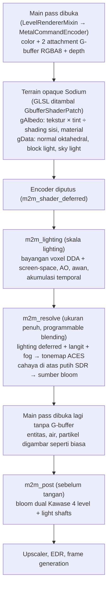

# Rancangan: Native Metal Shader Engine (`mine2metal`)

Dokumen ini merinci arsitektur, model matematika, tata letak memori, strategi optimasi perangkat keras Apple Silicon (khususnya **MacBook Air M3 16GB RAM**), sistem konfigurasi kualitas bertingkat hingga **Ray Tracing**, serta tahapan implementasi dan pengujian untuk **Native Metal Shader Engine** bawaan `mine2metal`.

---

## 1. Latar Belakang & Filosofi Desain

### 1.1 Mengapa Shader Native Metal?
Pada Minecraft biasa tanpa shader, waktu GPU di Apple M3 hanya sekitar **0,7–0,9 ms/frame** (dengan bagian dunia/`renderLevel` hanya **~0,12 ms**). Sebaliknya, ketika pemain menggunakan *shader pack* berbasis GLSL (seperti Iris/OptiFine) di macOS:
1. **Overhead Terjemahan Berlapis:** Shader GLSL lama diterjemahkan berlapis-lapis dan menggunakan hingga 8–16 tekstur G-Buffer (`colortex0..15` berformat `RGBA16Float`/`RGBA32Float`).
2. **Bottleneck Bandwidth TBDR:** Arsitektur *Tile-Based Deferred Renderer* (TBDR) pada GPU Apple Silicon sangat cepat selama data berada di *tile/register memory* atau dibaca dari tekstur *compressed* berformat ringkas, namun akan mengalami penurunan performa drastis dan *thermal throttling* (terutama pada MacBook Air M3 tanpa kipas) jika dipaksa menulis dan membaca ulang puluhan megabyte G-Buffer di setiap pass.
3. **Absennya Fitur Native Apple Silicon:** Jalur GLSL tidak memanfaatkan tipe `half` (`float16`) secara menyeluruh (yang memiliki *throughput* 2× lipat dan tekanan register separuh dari `float` sehingga mengaktifkan **Dynamic Caching** di GPU M3), tidak memiliki akses langsung ke struktur akselerasi/traversal Metal, dan tidak terhubung langsung dengan **MetalFX Temporal Upscaler**, **FSR 3.1 Frame Generation**, maupun **EDR (HDR) Output**.

### 1.2 Arah Visual: *Natural Cinematic*
Sesuai keputusan desain, gaya visual bawaan mengusung arah **Natural Cinematic** (terinspirasi dari *Complementary Reimagined*):
- **Mempertahankan Identitas Blok Minecraft:** Warna albedo blok tetap jernih dan dikenali, tidak tertelan kontras gelap berlebihan atau *color shift* ekstrem.
- **Langit, Atmosfer & Air yang Hidup:** Gradasi *Rayleigh/Mie scattering* saat matahari terbit/terbenam, sinar *crepuscular godrays* lembut menembus celah pepohonan, permukaan air dengan gelombang halus, refraksi kedalaman (*water absorption*), dan pantulan langit/dunia yang jernih.
- **Pencahayaan Emisif Hangat:** Lava, *lantern*, *glowstone*, *sea lantern*, *froglight*, dan obor memancarkan cahaya sekitar (*bounce/indirect lighting*) yang hangat ke dinding di sekitarnya serta memicu *bloom* lembut (dan *highlight* EDR di layar yang mendukung).

---

## 2. Arsitektur: G-buffer dari Terrain Sodium

Versi pertama shader ini hanya *post-process* di atas gambar yang sudah jadi. Warnanya sudah kena lightmap, shading sisi blok, AO, dan fog vanilla. Normal ditebak dari depth, dan material ditebak dari warna. Akibatnya gambar keruh (cahaya dikali dua kali), fog dobel, dan air salah terdeteksi. Shader pack seperti Complementary bekerja di tahap gambar dunia itu sendiri, jadi versi sekarang meniru cara itu:



- **Tambalan GLSL** dipasang di `GlslCompiler.compileToSpv` (`GlslCompilerMixin`), sebelum Mojang mengompilasi shader Sodium ke SPIR-V. Varian OIT (`#ifdef OIT`) dibiarkan. Output tambahan yang tidak punya attachment dibuang Metal (sudah diuji di bawah API validation).
- **Pipeline** terrain punya varian state dengan dua target RGBA8 ekstra (`MetalRenderPipeline.state(..., gbuffer)`). Pipeline lain di pass yang sama dapat write mask 0.
- **Pemecahan pass** terjadi tepat setelah `ChunkSectionsToRender.renderGroup(OPAQUE)` di `LevelRenderer.executeSolid`. `MetalRenderPass.resumeWithoutGbuffer` memasang ulang pipeline, scissor, vertex buffer, push constant, dan uniform di encoder baru.
- **Model cahaya** (`world_shaders.metal`): matahari × bayangan × N·L (daun tembus cahaya dari dua sisi + scattering), langit × sky light² × AO, block light mengikuti level cahaya Minecraft (jadi tetap terhalang dinding) dengan warna diambil dari sumber cahaya terdekat (soul lantern biru, dst.), dan emisif dari voxel grid atau permukaan full bright.
- **Dimensi**: G-buffer dipasang di semua dimensi; jenisnya dibaca dari skybox (overworld, `NONE` seperti Nether, `END`), jadi dimensi dari data pack ikut. Di Nether dan End tidak ada matahari, bayangan matahari, cahaya langit, maupun awan. Ambient diambil dari warna fog dimensi (Nether) atau ungu pucat (End), langit vanilla dipertahankan, dan fog mengikuti fog vanilla supaya cocok dengan entitas dan partikel. Lava, glowstone, dan kristal End bersinar lewat voxel grid dan bloom.
- **Entitas**: `GbufferShaderPatch` juga menambal `minecraft:core/entity`. Albedo diambil dari `Color` mentah × tekstur × `ColorModulator` (plus overlay merah saat terkena damage), normal dari turunan posisi, dan light dari `UV2`. Lighting deferred pindah ke akhir `LevelRenderer.executeSolid`, jadi entitas dan block entity solid ikut kena matahari, bayangan, AO, dan cahaya langit. Overlay blended (glint, mata bercahaya) tidak ditambal. Pipeline lain yang menggambar di jendela itu memakai varian MSL "penanda" (satu output `[[color(1)]]` bernilai nol), sehingga pikselnya dibiarkan seperti yang digambar vanilla.
- **Item & partikel**: `minecraft:core/item` ditambal sama seperti entitas, jadi item yang dijatuhkan, isi item frame, dan sebagainya ikut lighting deferred. Partikel solid (`core/particle`, pipeline `opaque_particle`) menulis material 4: karena billboard selalu menghadap kamera, resolve memberinya cahaya difus konstan (tanpa N·L), tetapi tetap kena bayangan voxel, AO, cahaya langit, dan block light. Piksel partikel yang semi-transparan ditandai material 0. Partikel translucent digambar setelah tahap deferred dan tetap vanilla.
- **Air**: sebelum `renderGroup(TRANSLUCENT)` di `executeClassicTransparency`, main pass diputus lagi. Warna dan depth scene opaque disalin, lalu terrain translucent digambar dengan G-buffer (air dikenali dari tint biome, +16 di material). Setelahnya, `m2m_water` menggambar ulang piksel air: gelombang prosedural, refraksi dari salinan scene, absorpsi Beer-Lambert sesuai kedalaman, SSR + langit, dan Fresnel. Partikel, cuaca, dan entitas translucent lanjut digambar di atasnya. Tidak jalan saat Improved Transparency (OIT) aktif atau saat Reflections & Water = Off.
- **Bawah air**: saat kamera di air (overworld), `FogRendererMixin` membuang fog environmental vanilla dari buffer GPU. Nilai aslinya tetap dipakai sebagai jarak pandang. `m2m_post` lalu menggambar fog absorpsi per warna (merah hilang duluan) dengan warna fog biome, plus berkas cahaya dari pola kaustik yang diproyeksikan dari permukaan (tinggi permukaan dicari di Java). Permukaan yang terendam (voxel di depannya air) diberi kaustik di resolve, sehingga terlihat dari atas maupun bawah. `m2m_water` menangani permukaan dari bawah: Snell's window dengan langit/dunia di atas, dan total internal reflection di luarnya.
- **Hujan**: hanya kalau di biome kamera memang turun hujan (`Biome.getPrecipitationAt == RAIN`; bukan salju atau gurun). Permukaan yang terbuka ke langit jadi lebih gelap, lebih jenuh, dan sedikit mengkilap. Di permukaan solid yang datar muncul genangan (noise yang tetap di dunia dan melebar saat hujan makin deras) yang memantulkan langit dengan Fresnel, plus riak cincin dari tetesan hujan. Riak yang sama muncul di permukaan air.
- **Reversed-Z**: MC 26.3 memanggil `setPerspective` dengan near/far tertukar, jadi depth bernilai 1 di dekat dan 0 di jauh/langit. Shader mengubah depth ke jarak lewat `m32 / (depth + m22)` dan mengenali langit dari nilai clear, sehingga tetap benar untuk kedua konvensi.
- **Optimasi**: ray voxel berhenti di atas blok tertinggi grid (`columnTops`) dan melompati blok kasar 4×4×4 yang kosong (`m2m_voxel_coarse`). SSR air berhenti begitu lintasannya di layar hanya akan membaca langit (tabel skyline, `m2m_skyline_reduce` + `m2m_skyline_levels`). Point light di-cull per tile 32×32 (`m2m_light_tiles`) dan hanya dihitung di piksel yang punya block light. Noise awan/gelombang/genangan dari tekstur 3D, warna langit dari LUT per frame (`m2m_sky_lut`). Bayangan, AO, dan awan dihitung bergantian per piksel (checkerboard temporal). Awan punya pass sendiri di setengah resolusi lighting, sampel bayangan-diri awan cukup 1 oktaf, dan bayangan awan di tanah hanya dihitung di piksel yang masih kena matahari. Light shaft (di udara dan di bawah air) dihitung di pass setengah resolusi. Jangkauan SSAO di layar dibatasi. Voxel grid ditulis CPU ke salinan master, lalu disalin ke salah satu dari 4 buffer GPU hanya kalau versinya berubah, jadi CPU tidak pernah menulis buffer yang sedang dibaca GPU. `M2M_SHADER_TIMES=1` dengan `-Dmine2metal.passTimes=true` menampilkan waktu GPU per tahap, dan `-Dmine2metal.shaderDebug=1..8` menampilkan buffer perantara (1 bayangan, 2 AO, 3 normal, 4 lightmap, 5 voxel).
- **Voxel grid** diperbarui langsung saat blok berubah (`ClientLevelMixin` → `sendBlockUpdated`). Scan bergiliran tetap berjalan untuk chunk yang baru dimuat.

## 3. Representasi Dunia 3D untuk Bayangan & Ray Tracing (Hybrid Voxel + Screen-Space)

Tantangan terbesar shader berbasis *post-processing* murni adalah ketidaktahuan terhadap geometri di luar layar (*off-screen*): begitu pemain menunduk dan matahari atau obor tidak lagi terlihat di layar, bayangan pohon/atap atau cahaya obor tiba-tiba hilang.

Untuk mengatasi hal ini secara *native* di Apple Silicon dengan penggunaan memori minimal (hanya **2 MB RAM** dari 16 GB yang tersedia):

### 3.1 Struktur Tekstur 3D Voxel (`128 × 128 × 128`, `MTLPixelFormatR8Uint`)
Sebuah tekstur 3D berukuran `128 × 128 × 128` voxel berpusat di sekitar kamera pemain (mencakup radius ±64 blok ke segala arah) menggunakan koordinat **Toroidal Wrapping** (`voxelCoord = worldBlockPos & 127`).
- Karena menggunakan pengalamatan *toroidal* (`modulo 128`), saat pemain berjalan, kita **tidak pernah menyalin ulang seluruh isi grid**. Hanya irisan blok baru di tepi gerakan kamera atau chunk/blok yang berubah yang diunggah ulang dari CPU ke GPU!
- Ukuran memori: `128 × 128 × 128 × 1 byte = 2.097.152 byte (2,0 MB)`.

### 3.2 Pengodean 8-Bit per Voxel (`uint8_t`)
Setiap byte voxel menyimpan jenis opasitas sekaligus warna/intensitas emisi cahaya blok:

| Nilai Byte (`uint8_t`) | Kategori Blok | Perilaku Saat *Ray Traversal* |
| :--- | :--- | :--- |
| `0x00` | Udara / Kosong (`air`, rumput pendek, bunga kecil) | Sinar lewat tanpa hambatan (`transmittance = 1.0`). |
| `0x01` | Blok Solid Opaque (batu, tanah, kayu, bijih, bangunan) | Menghentikan sinar sepenuhnya (`hit = true`, pembuat bayangan keras). |
| `0x02` | Dedaunan / Semi-Transparan (`leaves`, *cobweb*, bambu) | Mengurangi intensitas sinar sebesar faktor atenuasi daun & memberi sedikit *tint* hijau alami (*subsurface foliage transmission*). |
| `0x03` | Air (`water`) | Membiaskan dan menyerap cahaya sesuai kedalaman (*Beer-Lambert absorption*). |
| `0x04..0x0F` | Kaca Berwarna / Es (`glass`, *stained glass*, `ice`) | Meneruskan sinar dengan filter warna RGB sesuai warna kaca (*colored stained-glass shadows*). |
| `0x10..0xFF` | **Blok Emisif (Pemancar Cahaya)** | Bit `7..4` = Palet warna emisi (1: Oranye Api/Obor/Lava, 2: Kuning Hangat Glowstone/Lantern, 3: Biru Soul Fire/Soul Lantern, 4: Cyan Sea Lantern, 5: Ungu Amethyst/Crying Obsidian/End Rod, 6: Hijau/Kuning/Ungu Froglight, 7: Putih Cerah); Bit `3..0` = Intensitas cahaya (`1..15`). |

### 3.3 Daftar Emissive Point Lights Aktif (`M2MLightSource`, Maks 256 Sumber Terdekat)
Selain *voxel grid* untuk *ray marching*, `WorldShader.java` juga mengumpulkan hingga **256 sumber cahaya blok terdekat** dalam array ringkas (`float4 positionAndRadius`, `float4 colorAndIntensity`) di dalam buffer uniform frame. Dengan daftar ini:
- Pada preset **Low / Medium**, dinding di sekitar obor/lava langsung mendapatkan iluminasi dinamis yang mulus tanpa perlu menembakkan puluhan sinar *ray-tracing* per piksel.
- Pada preset **High / Ultra (RT)**, sinar *ray tracing* menggunakan metode **Next-Event Estimation (NEE) / Importance Sampling** langsung mengarah ke sumber cahaya emisif terdekat dan memverifikasi visibilitasnya (apakah terhalang tembok atau tidak) melalui *3D DDA Voxel Traversal*! Hasilnya: **bayangan obor/lava yang akurat di balik tembok/pilar tanpa *noise* bintik-bintik!**

---

## 4. Spesifikasi Algoritma per Tahap Shader (MSL)

Seluruh shader ditulis dalam **Metal Shading Language (MSL)** di `src/main/native/shaders.m` dengan pemisahan presisi:
- **Posisi 3D, kedalaman, dan proyeksi matriks:** `float` (`fp32`) agar bebas *jitter* dan *banding* jarak jauh.
- **Vektor normal, arah cahaya, warna RGB, AO, dan koefisien BRDF:** `half` / `half3` / `half4` (`fp16`) untuk menggandakan kecepatan ALU di GPU Apple M3.

### 4.1 Rekonstruksi Posisi 3D & Normal Permukaan Tajam (Pass 0)
Karena Sodium menggambar dunia secara langsung ke target warna dan kedalaman tanpa *G-Buffer normal attachment* tambahan, kita merekonstruksi posisi dunia 3D $\mathbf{P}$ dan vektor normal geometri $\mathbf{N}$ secara *on-the-fly* dari tekstur kedalaman `depth`:
1. Untuk piksel pada koordinat UV $(u, v)$ dengan kedalaman $d \in [0, 1)$, posisi relatif terhadap kamera dihitung melalui:
   $$\mathbf{P}_{\text{clip}} = \begin{bmatrix} 2u - 1 \\ 2v - 1 \\ d \\ 1 \end{bmatrix}, \quad \mathbf{P}_{\text{world}} = \text{invViewProj} \cdot \mathbf{P}_{\text{clip}}$$
2. Untuk mencegah tepi blok terlihat membulat di siluet kedalaman, turunan parsial $\partial \mathbf{P} / \partial x$ dan $\partial \mathbf{P} / \partial y$ dipilih dari pasangan tetangga kiri/kanan dan atas/bawah yang memiliki $|\Delta d|$ terkecil (*min-depth derivative reconstruction*):
   $$\mathbf{N} = \text{normalize}\left(\Delta \mathbf{P}_x \times \Delta \mathbf{P}_y\right)$$
3. **Klasifikasi Material Cepat dari Albedo & Normal:**
   - **Langit (`Sky`):** $d \ge 0.99999$.
   - **Air (`Water`):** Dideteksi dari karakteristik kromatisitas biru/cyan translusen + normal permukaan horizontal ($N_y > 0.85$) atau koordinat blok di dalam *voxel grid* bernilai `0x03`.
   - **Permukaan Emisif (`Emissive`):** Blok di *voxel grid* bernilai `>= 0x10` atau piksel dengan luminans lokal sangat tinggi pada area gelap.
   - **Dedaunan/Rumput (`Foliage`):** Dideteksi dari voxel `0x02` untuk efek *subsurface scattering* saat membelakangi matahari.

### 4.2 Sistem Bayangan (*Shadow Quality*)
1. **Low (*Screen-Space Contact Shadows*):**
   - Menembakkan 16 langkah *ray-march* di *screen-space depth* menuju arah matahari/bulan sepanjang jarak 2,5 meter dunia untuk menghasilkan bayangan kontak yang tajam pada rumput, batu, dan lekukan blok.
2. **Medium (*Soft Screen-Space + Horizon Shadows*):**
   - 24 langkah *screen-space ray march* dengan jitter spasial *Interleaved Gradient Noise (IGN)* + *soft penumbra* berdasarkan jarak okluder.
3. **High (*Hybrid 3D Voxel DDA + Screen-Space Shadows*):**
   - Menggabungkan *screen-space ray-march* jarak dekat (0 – 1,5 blok untuk detail mikro non-kubus seperti pagar/tangga/entitas) dengan algoritma **Amanatides & Woo 3D DDA Voxel Traversal** hingga 48 langkah melalui tekstur 3D Voxel (`128³`).
   - Pohon, atap rumah, tebing, dan gua menghasilkan bayangan matahari yang konsisten meskipun objek penghalangnya berada di belakang kamera!
4. **Ultra (*Ray-Traced PCSS + Colored Translucent Shadows*):**
   - Menembakkan sinar *cone/jittered* menuju piringan matahari (*disk sampling*) melalui 3D Voxel Grid hingga 80 langkah:
     - Menghitung jarak rata-rata penghalang (*blocker distance*) untuk menentukan lebar penumbra (**Percentage-Closer Soft Shadows / PCSS**): bayangan tajam di pangkal pohon dan semakin lembut membaur di kejauhan.
     - Saat sinar menembus voxel daun (`0x02`) atau kaca berwarna (`0x04..0x0F`), warna bayangan terfilter secara fisik menghasilkan **bayangan kaca patri berwarna** dan celah cahaya dedaunan.

### 4.3 *Ambient Occlusion* (`SSAO` / `GTAO` / `RTAO`)
1. **Low (`SSAO`):** 6 sampel hemisfer di ruang layar dengan radius adaptif terhadap kedalaman.
2. **Medium (`GTAO` - *Ground-Truth Ambient Occlusion*):**
   - Menghitung sudut horizon di sekitar piksel pada 2 arah irisan (*slices*) × 4 langkah per sisi menggunakan operasi `half` (`FP16`), memberikan bayangan sudut ruangan dan celah blok yang jauh lebih akurat secara fisik dibanding SSAO biasa.
3. **High (`RTAO` - *Ray-Traced Ambient Occlusion*):**
   - Menembakkan sinar *cosine-weighted hemisphere* pendek (radius 1,5 – 4 blok) di dalam *3D Voxel Grid* + *Screen-Space* untuk menangkap oklusi dari blok di luar layar (misalnya sudut plafon gua di atas kepala), lalu dihaluskan oleh *Spatial-Temporal Denoiser*.

### 4.4 *Global Illumination & Dynamic Emissive Lighting* (`Low` / `SSGI` / `RTGI`)
1. **Low (*Sky & Sun Bounce Tint*):**
   - Pencahayaan hemisfer langit (biru sejuk di permukaan menghadap atas) + pantulan *bounce* tanah hangat pada permukaan yang membelakangi matahari.
2. **Medium (`SSGI` + *Direct Emissive Lights*):**
   - *1-Bounce Screen-Space Diffuse GI* + iluminasi langsung (*inverse-square falloff* yang dihaluskan) dari hingga 64 sumber cahaya blok emisif terdekat (`M2MLightSource`).
3. **High (`RTGI` - *Voxel Ray-Traced GI & Shadowed Emissive Bounce*):**
   - Menguji visibilitas sinar (*shadow ray* via 3D Voxel DDA) dari piksel ke sumber cahaya emisif sekitar (lava, obor, lantern, glowstone) sehingga **cahaya obor tidak tembus dinding**, ditambah pantulan warna (*color bleeding*) dari blok sekitar yang terkena sinar matahari langsung.

### 4.5 Refleksi & Air (*Reflections & Water*)
1. **Low (*Fresnel Sky & Sun Specular*):**
   - Gelombang normal prosedural ringan pada air + hukum Fresnel Schlick:
     $$F(\theta) = F_0 + (1 - F_0)(1 - \cos\theta)^5, \quad F_0 = 0.02$$
   - Memantulkan gradien langit atmosferik dan kilau piringan matahari/bulan (*GGX specular highlight*).
2. **Medium (`SSR` - *Screen-Space Reflections*):**
   - Menembakkan sinar pantul $\mathbf{R} = \text{reflect}(-\mathbf{V}, \mathbf{N}_{\text{wave}})$ di *screen-space depth* (24 langkah hierarkis/linear dengan *binary refinement*).
3. **High (*SSR + Dual-Layer Gerstner Waves + Depth Refraction*):**
   - Gelombang air multi-oktaf yang bergerak mulus, *Beer-Lambert underwater color absorption* (air dangkal jernih kehijauan, air dalam biru pekat), *foam* tipis di tepi kontak blok, dan SSR 36 langkah.
4. **Ultra (*Hybrid Ray-Traced Reflections*):**
   - Jika sinar SSR keluar dari layar atau terhalang objek latar depan (*disocclusion*), sinar otomatis melanjutkan *traversal* di dalam **3D Voxel Grid** untuk memantulkan blok tebing, bangunan, dedaunan, dan lampu/lava yang berada di luar layar (*off-screen*), dipadukan dengan langit atmosferik!

### 4.6 Atmosfer & *Volumetric Lighting (Godrays)*
- **Scattering Atmosfer Natural Cinematic:**
  - Gradien warna langit dihitung dari sudut elevasi matahari $\mu = \mathbf{V} \cdot \mathbf{L}_{\text{sun}}$ dengan transisi mulus antara:
    - **Siang:** Biru langit cerah dengan *horizon haze* putih-kebiruan lembut.
    - **Golden Hour (Sunrise / Sunset):** Oranye keemasan hangat di sekitar matahari yang bergradasi ke ungu-lembayung di zenit.
    - **Malam:** Biru malam tua sinematik dengan cahaya bulan perak-kebiruan (tetap terlihat nyaman dimainkan tanpa gelap buta).
    - **Hujan / Badai:** Desaturasi atmosfer otomatis dengan kabut tebal berlapis dan permukaan tanah/batu yang tampak basah (*wetness specular*).
- **Volumetric Godrays (*Crepuscular Rays*):**
  - *Ray-marching* volumetrik sepanjang vektor pandangan $\mathbf{V}$ (8 / 16 / 24 langkah dengan *blue-noise / IGN dithering*): menguji apakah titik sampel di udara terkena sinar matahari langsung (melalui *depth buffer* & *3D Voxel shadow check*) dan mengakumulasi hamburan fase **Henyey-Greenstein** ($g = 0.76$).
  - Saat pemain berada di dalam air (`isUnderwater`), *godrays* berubah menjadi berkas cahaya bawah air (*underwater caustic shafts*)!

### 4.7 *Dual-Kawase Bloom* & *Natural Cinematic Tonemapping*
- **Dual-Kawase Pyramid Bloom:**
  - 4 tingkat *downsample* (`1/2`, `1/4`, `1/8`, `1/16`) dan 4 tingkat *upsample* dengan filter *tent* 5-tap. Biaya GPU di M3 kurang dari **0,15 ms** pada resolusi 1080p/1200p karena ukuran teksturnya mengecil secara eksponensial.
- **Natural Cinematic Tonemapping (Kompatibel SDR & EDR/HDR):**
  - Mengubah warna *linear HDR* hasil pencahayaan menjadi warna akhir dengan kurva *ACES-inspired Natural Cinematic* (menjaga saturasi warna langit dan blok tetap natural tanpa membuat warna merah/kuning menjadi pucat):
    - **Saat SDR (`hdr == false`):** Dipetakan ke $[0, 1]$ lalu dikodekan kembali ke sRGB.
    - **Saat EDR/HDR (`hdr == true`):** Menggunakan kurva *soft-shoulder* yang mengizinkan luminans di atas `1.0` mengalir mulus hingga `hdrFramePeak` (200%–400% SDR white), sehingga [`hdr.m`](file:///Volumes/Hoshizora_SSD/Learning/mine2metal/src/main/native/hdr.m) dan *Frame Generation* menerima data warna yang konsisten.

---

## 5. Strategi Optimasi Khusus MacBook Air M3 (16GB RAM)

Agar shader berjalan sangat lancar di MacBook Air M3 tanpa memicu *thermal throttling*:

| Teknik Optimasi | Implementasi di `mine2metal` | Dampak Performa |
| :--- | :--- | :--- |
| **1. *Configurable Lighting Scale* (`50%`, `75%`, `100%`)** | Pass berat (Shadows, AO, GI, Godrays, Reflections) dihitung pada tekstur berukuran `shaderLightingScale` (default `75%`, atau `50%` pada mode hemat), lalu digabungkan ke resolusi penuh menggunakan **Joint Bilateral Upsampling** (berbobot kedalaman & normal sehingga tepi blok tetap 100% tajam!). | Menghemat **44% – 75%** beban *ray marching* tanpa mengaburkan tekstur blok! |
| **2. *Spatial-Temporal Reprojection* (History Accumulation)** | Tekstur pencahayaan menyimpan riwayat frame sebelumnya (`lightingHistory[2]`) yang direprojeksikan ulang menggunakan matriks `previousViewProjection` dari [`CameraMotion`](file:///Volumes/Hoshizora_SSD/Learning/mine2metal/src/main/java/dev/mine2metal/frame/CameraMotion.java). | Memungkinkan jumlah sampel *ray-tracing* per frame tetap rendah (1–2 ray/piksel) namun menghasilkan kualitas setara 16–32 sampel dalam 4–8 frame! |
| **3. Komputasi `half` (`FP16`) Menyeluruh** | Semua kalkulasi BRDF, interpolasi warna, filter *bilateral*, dan *bloom* memakai `half` / `half3` / `half4`. | Mengaktifkan *dual-issue FP16* dan menjaga penggunaan register di bawah ambang **Dynamic Caching** M3. |
| **4. *Early-Out* Langit & Jarak Jauh** | Piksel langit (`depth == 1.0`) langsung melewati seluruh *loop* Shadow, AO, dan GI. Objek di luar radius bayangan langsung menggunakan *analytic sky/sun shading*. | Memangkas **30% – 50%** instruksi shader saat pemain melihat ke arah horizon. |
| **5. *Incremental Toroidal Voxel Update*** | Di Java (`WorldShader.java`), satu baris grid (97 kolom dengan z dunia yang sama) dipindai per frame dan ditulis ke salinan master *off-heap* (`2 MB`); irisan z yang berubah dilaporkan ke native (`m2m_shader_voxels_changed`), dan tiap salinan GPU hanya menyalin irisan tertundanya (16 KB per irisan). | Beban CPU tambahan di bawah **0,15 ms/frame** dan penggunaan RAM tetap **2 MB**. |
| **6. Skyline untuk SSR air** | Dua kernel compute membuat tabel baris tertinggi non-langit per pita 16 kolom plus tabel sparse range-max. Lintasan ray di layar adalah garis, jadi `sky_from` menghitung sekali per ray dari jarak mana setiap sampel pasti langit, dan ray berhenti di sana. | Pass air 2,02 → 1,40 ms (1920×1243), hasil identik (≤ 1 level). |
| **7. Light tiles** | Kernel compute per tile 32×32: bola tiap point light diuji terhadap frustum tile dan rentang depth-nya; resolve hanya mengiterasi bit cahaya yang lolos, dan hanya di piksel yang punya block light. | Resolve 0,94 → 0,54 ms; 0 piksel berbeda. |
| **8. DDA voxel dua tingkat** | Grid kasar 32³ (byte per blok 4×4×4, dibangun kernel saat salinan voxel diperbarui); ray melompati blok kasar kosong ke titik keluarnya. | Lighting 0,90 → 0,78 ms; 8 piksel beda ≤ 2 level. |
| **9. Noise dan langit dari tekstur** | Value noise dari tekstur 3D R16Unorm 128³ (periodik 32 unit, 4 texel/unit) menggantikan 8 hash + 7 mix per sampel; `atmosphere()` dihitung sekali per frame ke LUT lat-long 512×256 dan di-sample. | Awan 0,57 → 0,19 ms; LUT ±0,25 ms di air, resolve, awan. |
| **10. Marching di clip space** | SSR dan sampel AO memproyeksikan sekali; tiap langkah hanya multiply-add. | Kecil, tapi gratis. |
| **11. Tahap air hanya bila ada terrain translucent** | `SodiumTerrain` membaca render list Sodium (storage pass TRANSLUCENT per region + slice mask section) sebelum salinan scene; tanpa section translucent, salinan, skyline, dan pass air dilewati. | ±0,3 ms di pemandangan tanpa air. |
| **12. sRGB oleh hardware** | Resolve, air, dan post menggambar ke view sRGB tekstur warna dan membaca salinan scene lewat view sRGB; function constant `linearIo` memilih varian pipeline tanpa konversi (format tanpa varian sRGB memakai varian dengan konversi eksplisit). | ±0,1 ms. |

Total pass shader di 1920×1243 (Apple M3): High 5,11 → 3,81 ms, Ultra 5,47 → 3,98, Medium 4,56 → 3,58, Low 50 % 2,90 → 2,48. Alat ukurnya `tools/shaderbench` (dunia sintetis, tiap pass di command buffer sendiri; detail di [roadmap](roadmap.md#optimasi-shader-dunia-dan-jalur-cpu-2026-10-30)).

---

## 6. Spesifikasi Pengaturan & Preset Kualitas

### 6.1 Tabel Matriks Preset (`ShaderPreset`)

| Opsi Pengaturan | `OFF` | `LOW` | `MEDIUM` | `HIGH` | `ULTRA (RT)` |
| :--- | :---: | :---: | :---: | :---: | :---: |
| **Shadow Quality** | `OFF` | `LOW` (Contact) | `MEDIUM` (Soft SS) | `HIGH` (Voxel Hybrid) | `ULTRA` (RT PCSS + Colored) |
| **Ambient Occlusion** | `OFF` | `LOW` (SSAO) | `MEDIUM` (GTAO) | `MEDIUM` (GTAO) | `HIGH` (RTAO) |
| **Reflections & Water** | `OFF` | `LOW` (Fresnel) | `MEDIUM` (SSR) | `HIGH` (SSR + Waves) | `ULTRA` (RT Hybrid) |
| **Global Illumination** | `OFF` | `LOW` (Sky Bounce) | `MEDIUM` (SSGI + Lights) | `HIGH` (RTGI + Shadowed Lights) | `HIGH` (RTGI + Shadowed Lights) |
| **Volumetric Godrays** | `OFF` | `LOW` (8 steps) | `MEDIUM` (16 steps) | `HIGH` (24 steps) | `HIGH` (24 steps) |
| **Bloom & Tonemap** | `OFF` | `LOW` | `MEDIUM` | `HIGH` | `HIGH` |
| **Lighting Scale** | `75%` | `50%` | `75%` | `75%` | `75%` (dapat diatur `50%–100%`) |

> [!TIP]
> Saat pengguna memilih `LOW`, `MEDIUM`, `HIGH`, atau `ULTRA`, keenam sub-opsi otomatis terisi sesuai tabel di atas. Jika pengguna mengubah salah satu sub-opsi secara manual (misalnya memakai preset `MEDIUM` tetapi menaikkan **Reflections & Water** ke `ULTRA`), maka pilihan **Shader Preset** otomatis berpindah ke `CUSTOM`.

### 6.2 Kunci Penyimpanan di `config/mine2metal.properties`
```properties
# Native Metal Shaders (Natural Cinematic)
# shaderPreset: off | low | medium | high | ultra | custom
shaderPreset=off
shaderShadows=off
shaderAo=off
shaderReflections=off
shaderGi=off
shaderVolumetrics=off
shaderBloom=off
shaderLightingScale=75
```

### 6.3 Tata Letak UI (Sodium & Vanilla)
1. **Pada Sodium (`SodiumOptionsPage.java`):**
   - Menambahkan halaman/tab kedua bernama **"Metal Shaders"** (`mine2metal.options.shaders_page`) tepat di bawah/sebelah halaman **"Metal"**:
     - **Grup 1 — Preset & Resolusi Pencahayaan:** `Shader Preset`, `Shader Lighting Scale (50%–100%)`.
     - **Grup 2 — Bayangan & Pencahayaan (Ray Tracing):** `Shadow Quality`, `Global Illumination (GI)`, `Ambient Occlusion`.
     - **Grup 3 — Air, Refleksi & Efek Kamera:** `Reflections & Water`, `Volumetric Godrays`, `Bloom & Tonemapping`.
2. **Pada Layar Vanilla (`MetalSettingsScreen.java`):**
   - Menambahkan bagian *header* **"Metal Shaders"** lengkap dengan tombol siklus (*CycleButton*) dan *slider* yang saling tersinkronisasi ketika pengguna mengganti `Shader Preset`.

---

## 7. Kontrak C ABI (`mine2metal.h`) & Struktur Data Native

### 7.1 Struktur Uniform `M2MShaderParams` (`float[]` dari Java → Native)
Dikirim sekali per frame ke `m2m_shader_render`:
- `matrices[0..51]` (`52 float`): `invViewProj`, `prevViewProj`, `cameraDelta (dx, dy, dz, valid)`, `invPrevViewProj` (menggunakan format [`CameraMotion`](file:///Volumes/Hoshizora_SSD/Learning/mine2metal/src/main/java/dev/mine2metal/frame/CameraMotion.java) yang sudah teruji!).
- `environment[0..31]` (`32 float`):
  - `[0..2]`: `cameraWorldPos (x, y, z)` (untuk pengalamatan *toroidal* Voxel Grid).
  - `[3]`: `timeSeconds` (animasi gelombang air & awan).
  - `[4..6]`: `sunDirection (x, y, z)` (vektor satuan menuju matahari/bulan).
  - `[7]`: `daylightFactor` (`0.0` malam – `1.0` siang).
  - `[8]`: `twilightFactor` (`0.0` biasa – `1.0` puncak *sunrise/sunset*).
  - `[9]`: `rainStrength` (`0.0` cerah – `1.0` hujan deras).
  - `[10]`: `thunderStrength` (`0.0` – `1.0`).
  - `[11]`: `isUnderwater` (`0.0` atau `1.0`).
  - `[12]`: `dimensionType` (`0` Overworld, `1` Nether, `2` End).
  - `[13..15]`: `skyColor (r, g, b)`.
  - `[16..18]`: `fogColor (r, g, b)`.
  - `[19..20]`: `nearPlane`, `farPlane`.
  - `[21]`: `hdrActive` (`0.0` SDR, `> 1.0` puncak EDR).
  - `[22]`: `frameIndex` (untuk rotasi sampel *Blue Noise / Interleaved Gradient Noise* temporal).
- `lights[0..(8 * lightCount - 1)]`: Array sumber cahaya emisif (`x, y, z, radius, r, g, b, intensity`) relatif terhadap posisi kamera.

### 7.2 Fungsi Ekspor Baru di `mine2metal.h`
```c
// Mengunggah irisan atau seluruh isi 3D Voxel Grid (128x128x128, R8Uint) dari memori off-heap Java.
M2M_EXPORT void m2m_shader_update_voxels(int64_t ctx, int32_t x, int32_t y, int32_t z,
                                         int32_t width, int32_t height, int32_t depth,
                                         int64_t data_address, int32_t bytes_per_row, int32_t bytes_per_image);

// Menjalankan pipeline Native Metal Shader pada tekstur warna dan depth dunia.
// Mengembalikan 1 jika berhasil dirender ke tekstur warna dunia, atau 0 jika dilewati.
M2M_EXPORT int32_t m2m_shader_render(int64_t ctx, int64_t color_texture, int64_t depth_texture,
                                     const int32_t *quality_levels, const float *matrices,
                                     const float *environment, const float *lights, int32_t light_count);

// Membebaskan tekstur history, bloom pyramid, dan voxel grid saat shader dimatikan.
M2M_EXPORT void m2m_shader_release(int64_t ctx);

// Irisan z grid voxel (0..127) yang ditulis CPU sejak panggilan terakhir; salinan GPU hanya menyalin irisan itu.
M2M_EXPORT void m2m_shader_voxels_changed(int64_t ctx, int32_t z_min, int32_t z_max);
```

---

## 8. Rencana Implementasi & Verifikasi Bertahap

| Tahap | File yang Dibuat / Diubah | Target Verifikasi |
| :--- | :--- | :--- |
| **Tahap 1: Konfigurasi, Preset & UI ("Metal Shaders")** | [`MetalSettings.java`](file:///Volumes/Hoshizora_SSD/Learning/mine2metal/src/main/java/dev/mine2metal/config/MetalSettings.java), [`MetalOptionTexts.java`](file:///Volumes/Hoshizora_SSD/Learning/mine2metal/src/main/java/dev/mine2metal/config/MetalOptionTexts.java), [`SodiumOptionsPage.java`](file:///Volumes/Hoshizora_SSD/Learning/mine2metal/src/main/java/dev/mine2metal/config/SodiumOptionsPage.java), [`MetalSettingsScreen.java`](file:///Volumes/Hoshizora_SSD/Learning/mine2metal/src/main/java/dev/mine2metal/config/MetalSettingsScreen.java), [`en_us.json`](file:///Volumes/Hoshizora_SSD/Learning/mine2metal/src/main/resources/assets/mine2metal/lang/en_us.json), [`id_id.json`](file:///Volumes/Hoshizora_SSD/Learning/mine2metal/src/main/resources/assets/mine2metal/lang/id_id.json) | Tab **Metal Shaders** tampil di Sodium & layar Vanilla; pemilihan preset mengubah sub-opsi secara otomatis; perubahan sub-opsi menggeser preset ke `Custom`; tersimpan di `mine2metal.properties`. |
| **Tahap 2: Native MSL Shader Engine (`shaders.m`)** | `src/main/native/shaders.m`, [`mine2metal.h`](file:///Volumes/Hoshizora_SSD/Learning/mine2metal/src/main/native/mine2metal.h), [`m2m_context.h`](file:///Volumes/Hoshizora_SSD/Learning/mine2metal/src/main/native/m2m_context.h), [`MetalNative.java`](file:///Volumes/Hoshizora_SSD/Learning/mine2metal/src/main/java/dev/mine2metal/metal/MetalNative.java), [`MetalRenderer.java`](file:///Volumes/Hoshizora_SSD/Learning/mine2metal/src/main/java/dev/mine2metal/metal/MetalRenderer.java) | Kompilasi bersih `-Wall -Wextra -Werror`; semua 4 pipeline MSL (`lighting`, `denoise`, `bloom_down/up`, `composite`) terkompilasi tanpa error di Metal 3 dan Metal 4. |
| **Tahap 3: Pengumpul Voxel Dunia & Integrasi `WorldPass`** | `src/main/java/dev/mine2metal/frame/WorldShader.java`, [`WorldPass.java`](file:///Volumes/Hoshizora_SSD/Learning/mine2metal/src/main/java/dev/mine2metal/frame/WorldPass.java) | Pemindaian inkremental blok sekitar kamera (solid, air, daun, kaca, emisif lava/obor/lantern) + pengiriman matriks & atmosfer ke `m2m_shader_render` sebelum `upscaler.end(current)`. |
| **Tahap 4: Build JAR, Uji Kompatibilitas & Deploy ke `mods/`** | `build/libs/mine2metal-0.0.1.jar` → `~/Library/Application Support/minecraft/mods/` | Kompilasi penuh berhasil, kompatibel dengan Upscaling, HDR (EDR), dan Frame Generation, serta siap diuji langsung di dalam game! |
